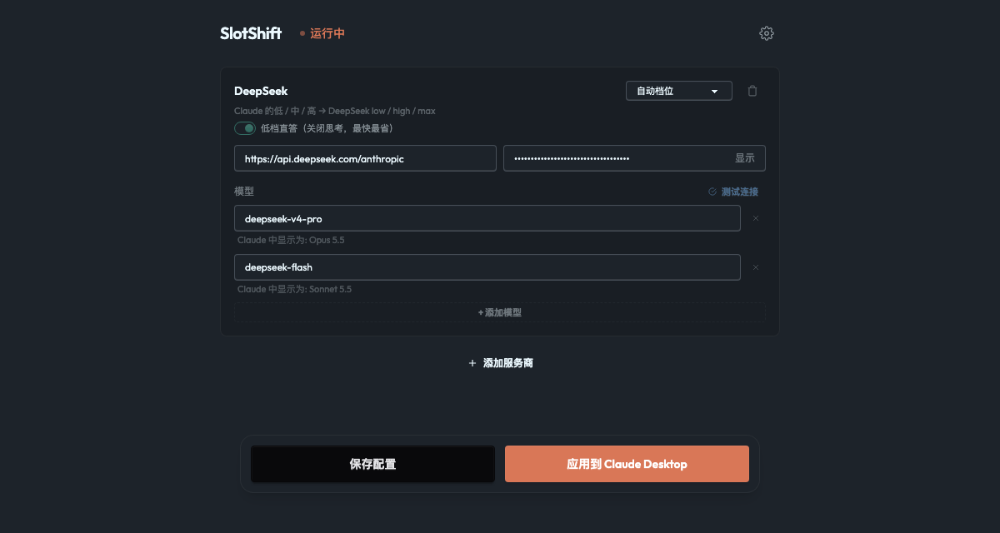

<div align="center">


# SlotShift

**把任意模型换进 Claude 的模型位**

DeepSeek · Kimi · GLM · MiniMax · 百炼 · mimo — 一个本地代理，让 Claude Desktop / Claude Code 用上你真正想用的模型。

[](https://creativecommons.org/licenses/by-nc-nd/4.0/)
[](#安装)
[](https://github.com/banboat/SlotShift/releases)

</div>

## 为什么叫 SlotShift

Claude 的模型选择器是几个固定的「模型位」：Opus 5.5、Sonnet 5.5、Fable 5.2、Haiku 5.5……

SlotShift 做的事情，就是把你的 DeepSeek / Kimi / GLM 模型**换位**到这些座位上：

- Claude 看到的是官方模型名，选择器、档位、提示都能正常工作；
- 实际请求由本地代理转发到你配置的上游模型；
- 推理档位也会被翻译：低 / 中 / 高 → DeepSeek 的 `low` / `high` / `max`，低档还可以直接关闭思考。

一句话：**Claude 的界面，你的模型。**

## 功能

- 自动读取 Claude 官方模型目录，映射到当前 Claude Code 的官方模型位（Opus 5.5 / Sonnet 5.5 / Fable 5.2 / Haiku 5.5 …）
- 每个上游模型只出现一次，不再有重复的 1M 条目
- 可选显示官方 Claude 名称，或真实上游模型名
- 档位适配：
  - DeepSeek 三档：低 / 中 / 高 → `low` / `high` / `max`
  - 低档「直答」：关闭 thinking + 结论优先指令，最快最省
  - 其他服务商可保留 Claude 原生五档
- 多服务商、多模型（最多 8 个）
- 一键测试所有模型，直接指出不可用的模型 ID
- 菜单栏常驻、深浅色主题、请求日志、开机自启

## 工作方式

```text
Claude Desktop / Claude Code
        │  model: claude-opus-5-5
        ▼
   SlotShift (127.0.0.1:5678)
        │  model: deepseek-v4-pro
        │  effort: high
        ▼
   DeepSeek / Kimi / GLM / …
```

SlotShift 读取 Claude 自己维护的模型目录（`Claude-3p/model-catalog/published.json`），把官方模型位和真实上游模型对上；Claude 升级模型后不需要改代码。

## 界面



## 下载

从 [Releases](https://github.com/banboat/SlotShift/releases/latest) 下载：

| 平台 | 文件 |
|------|------|
| macOS | `SlotShift.dmg` |
| Windows | `SlotShift-Windows.zip`（自行构建，见下文） |

## 安装

### macOS

1. 下载 `SlotShift.dmg`，双击打开
2. 将 `SlotShift.app` 拖入「应用程序」文件夹
3. 首次打开如果提示「已损坏」，在终端执行：
   ```bash
   xattr -cr /Applications/SlotShift.app
   ```
4. 双击打开即可

### Windows

仓库目前只包含 macOS 打包脚本。Windows 可用 Rust 交叉编译：

```bash
rustup target add x86_64-pc-windows-gnu
brew install mingw-w64
cargo build --release --target x86_64-pc-windows-gnu
```

确保 `SlotShift.exe` 和 `WebView2Loader.dll` 在同一目录。

## 首次使用

### macOS

1. 打开 **SlotShift**
2. 点击「添加服务商」，选择预设或自定义，填写 API 地址和密钥
3. 点击「测试连接」确认每个模型都可用
4. 点击「保存配置」，然后点击「**应用到 Claude Desktop**」
5. Claude Desktop 会自动重启，在模型选择器中选择 Opus 5.5 / Sonnet 5.5 即可

> SlotShift 启动时会自动配置 Claude Desktop 的第三方推理设置，无需手动操作。

### Windows

1. 打开 **SlotShift**
2. 添加服务商、填写密钥、测试连接、保存配置
3. 点击「应用到 Claude Desktop」
4. 首次使用若 Claude 没有自动配置，打开 **☰ → Developer → Configure third-party inference → Form view**：
   - **Gateway URL**：`http://127.0.0.1:5678`
   - **API Key**：`proxy`
   - 点击 **Apply locally**

> SlotShift 需要保持运行。关闭窗口后会缩到菜单栏/系统托盘继续工作，不影响 Claude Desktop。

## 模型位映射

按 SlotShift 里配置的模型顺序绑定：

| 顺序 | Claude 模型位 | 你的模型（示例） |
|------|---------------|------------------|
| 1 | Opus 5.5 | `deepseek-v4-pro` |
| 2 | Sonnet 5.5 | `deepseek-flash` |
| 3 | Fable 5.2 | … |
| 4 | Haiku 5.5 | … |

- 第一个模型对应 Opus 5.5，第二个对应 Sonnet 5.5，依此类推；最多 8 个。
- 设置页打开「真实模型名」后，选择器会显示 `deepseek-v4-pro`，而不是 `Opus 5.5`。
- 模型行下面会直接显示「Claude 中显示为: …」，可当场核对。

## 推理档位

Claude 官方给 Opus 5.5 / Sonnet 5.5 五档：**低 / 中 / 高 / 额外 / 最高**（`low` / `medium` / `high` / `xhigh` / `max`），默认推荐「中」。

DeepSeek V4 Pro / V4.1 Flash 的模型卡只声明三档：`low` / `high` / `max`，默认 `high`；`effort` 和 `budget_tokens` 都是软约束，不是硬预算。

因此默认的「自动档位」会：

1. 用 Claude 官方字段 `maxEffort: high` 把选择器裁成三档：低 / 中 / 高；
2. 代理层按顺序映射：

| Claude | DeepSeek | 说明 |
|--------|----------|------|
| 低 Low | 直答（关闭 thinking） | 最快最省；追加 fast-mode 指令，结论优先 |
| 中 Medium | `high` | DeepSeek 默认档 |
| 高 High | `max` | 最深思考 |

> 实测：同一道 3×10 多米诺题，低档直答 **3.5 秒 / 94 tokens** 给出正确答案；旧的低档软映射要 **81 秒 / 3,420 thinking tokens**。中/高仍是 DeepSeek 的软偏好，难题上都会长时间思考；真正确定的能力/成本差异来自 **Pro 与 Flash 的选择**。

服务商卡片的「推理档位」还可以选：

- **Claude 五档**：原样透传 `low` / `medium` / `high` / `xhigh` / `max`；
- **关闭思考**：发送 `thinking: disabled`；
- **低档直答**：勾选后，低档关闭 thinking 并追加 fast-mode 指令；取消勾选则恢复纯 `low/high/max` 映射。

## 配置与迁移

- 配置文件：`~/.slotshift/config.json`
- 从旧版 ModelSwitch 升级会自动读取 `~/.claude-model-proxy/config.json`，无需重新填写密钥。
- 开机自启会迁移到 `~/Library/LaunchAgents/com.slotshift.plist`。
- Claude 的 gateway 配置 id 保持不变，已应用的配置不会丢。

## 构建

需要 Rust 工具链：

```bash
# macOS
cargo build --release
./package.sh        # 生成 SlotShift.app + SlotShift.dmg

# Windows（交叉编译）
rustup target add x86_64-pc-windows-gnu
brew install mingw-w64
cargo build --release --target x86_64-pc-windows-gnu
```

## 更新日志

### v1.2.0

- 项目更名为 **SlotShift**
- 配置目录迁移到 `~/.slotshift`，自动读取旧版配置
- 开机自启迁移到 `com.slotshift.plist`
- 全新的品牌、图标与 README

### v1.1.0

- 模型位读取 Claude 官方模型目录，跟随 Opus 5.5 / Sonnet 5.5 / Fable 5.2 / Haiku 5.5
- 修复模型选择器重复条目（1M 变体多一行）
- 新增「真实模型名」开关
- 推理档位适配：DeepSeek 三档 / Claude 五档
- 新增「低档直答」：关闭 thinking，最快最省
- 「测试连接」逐个检查所有模型，并列出失败的模型 ID

### v1.0.0

- 首个版本

## 许可证

本项目采用 [CC BY-NC-ND 4.0](https://creativecommons.org/licenses/by-nc-nd/4.0/) 许可证。
